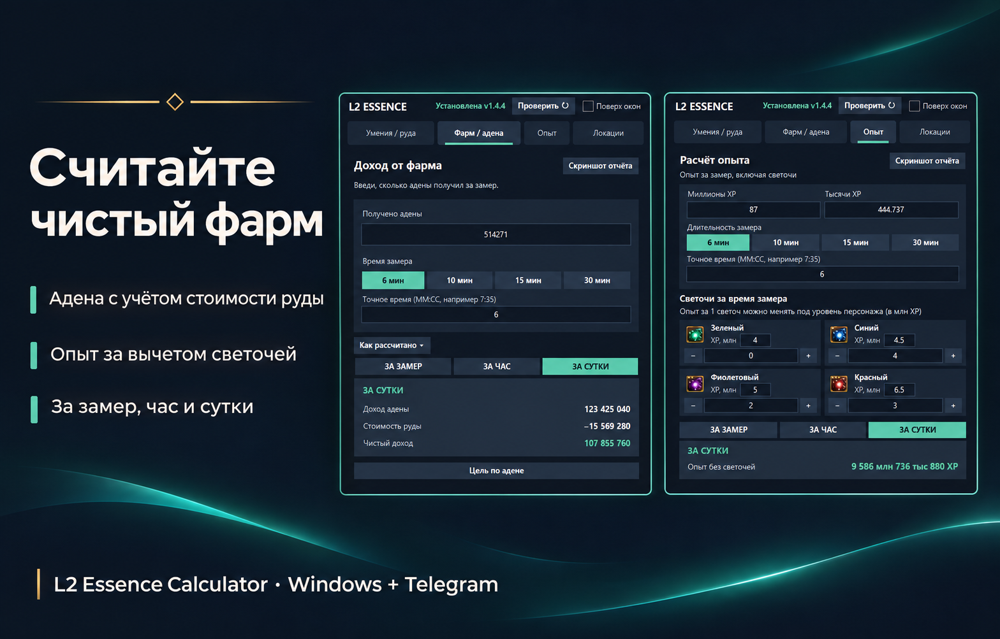
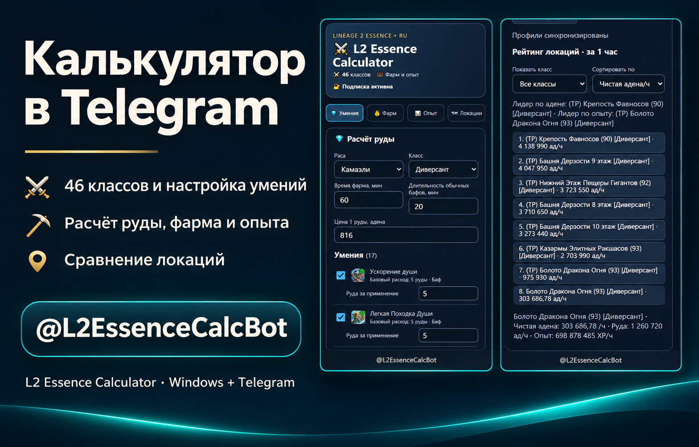

# ⚔️ L2 Essence Calculator

**Калькулятор фарма, адены, опыта и расхода Руды Духов для Lineage 2 Essence RU.**

Посмотрите, сколько чистой адены и опыта приносит фарм, сколько руды уходит на умения и какая локация выгоднее для вашего персонажа. В Windows-версии доступны **все 46 классов восьми рас**.

[📥 Скачать для Windows](https://github.com/Teatimo/L2-Essence-Calculator-Updates/releases/latest) · [📱 Открыть в Telegram](https://t.me/L2EssenceCalcBot) · [🛒 Приобрести подписку](https://funpay.com/users/11571233/) · [📋 История обновлений](https://github.com/Teatimo/L2-Essence-Calculator-Updates/releases)

## 🚀 Возможности

### ⚔️ Умения и расход Руды Духов

- Выберите расу и класс. У каждого класса свой список умений с русскими названиями и игровыми иконками.
- Отметьте баффы, призывы и другие умения, которые используете на фарме. Расход руды за применение можно изменить вручную.
- Укажите общую длительность обычных баффов. Для отдельных умений можно настроить время действия и точный откат в секундах.
- Калькулятор покажет расход руды и его стоимость в адене **за час и за выбранный период**.
- Умения можно перетаскивать за значок **☷**. Порядок сохраняется отдельно для каждого класса.

### 💰 Фарм, чистая адена и цель накопления

- Введите адену из игрового отчёта и время замера. Можно выбрать готовый период или ввести точное время в формате `ММ:СС`, например `7:35`.
- Калькулятор покажет **доход, стоимость руды и чистую прибыль**. В режиме **«ЗА ЗАМЕР»** расход руды считается за фактическое время. Режимы **«ЗА ЧАС»** и **«ЗА СУТКИ»** показывают прогноз.
- В окне **«Цель по адене»** укажите нужную сумму, сколько уже накоплено и сколько часов в день вы фармите. Калькулятор оценит, сколько часов и игровых дней осталось.

### ✨ Опыт и светочи

- Укажите общий опыт за замер и количество зелёных, синих, фиолетовых и красных светочей.
- При необходимости измените опыт за один светоч под уровень своего персонажа.
- Калькулятор вычтет опыт светочей из общего результата и покажет **опыт обычного фарма за замер, за час и за сутки**.

### 📸 Импорт игрового отчёта на Windows

- Откройте скриншот или вставьте его из буфера обмена. На снимке могут быть игровой отчёт и таблица светочей с любой стороны от него.
- Калькулятор распознаёт адену, общий опыт, время и данные светочей. Поддерживаются числа в миллиардах. OCR встроен в приложение, отдельная установка не требуется.
- Проверьте распознанные числа и при необходимости исправьте их в том же окне. После этого можно сразу увидеть чистую адену, XP без светочей и расход руды в час.
- Выберите или создайте локацию прямо в окне импорта. Добавьте название и заметку, например условия фарма, экипировку или набор баффов. Затем нажмите **«Сохранить замер»**.

### 🗺️ Локации, история и сравнение

- У каждой локации свой профиль с классом и настройками умений. Переключение класса само по себе не создаёт новый профиль.
- Сохраняйте несколько замеров на одну точку. В истории можно искать по названию и заметке, просматривать результаты и удалять отдельные записи.
- Сравнивайте локации по **чистой адене в час** или **опыту без светочей в час**. Рейтинг можно отфильтровать по классу.
- Режим **«Рейтинг по среднему из истории»** учитывает результаты нескольких замеров. Более длинные замеры имеют больший вес.

### 📱 Калькулятор в Telegram

- Откройте **@L2EssenceCalcBot**, нажмите **«Открыть калькулятор»** и привяжите подписку одноразовым кодом.
- В Mini App доступны расчёты руды, фарма и опыта, а также профили локаций. Данные игрового отчёта вводятся вручную.
- Чтобы перенести профили с ПК, нажмите **«Синхронизировать профили с Telegram»** в Windows, затем **«Обновить профили»** в Mini App. История отдельных замеров и заметки хранятся на ПК.

## 🧬 Все 46 классов

| Раса | Классов | Доступные классы |
|---|---:|---|
| **Люди** | 14 | Апостол, Архимаг, Ассасин, Авантюрист, Варг, Дуэлист, Кардинал, Пожиратель Душ, Полководец, Рыцарь Ада, Рыцарь Смерти, Рыцарь Феникса, Снайпер, Чернокнижник |
| **Светлые эльфы** | 8 | Виртуоз, Жрец Евы, Магистр Магии, Мастер Стихий, Рыцарь Смерти, Страж Лунного Света, Странник Ветра, Храмовник Евы |
| **Тёмные эльфы** | 10 | Ассасин, Владыка Теней, Жрец Шилен, Кровавая Роза, Повелитель Бури, Призрачный Охотник, Призрачный Танцор, Рыцарь Смерти, Страж Теней, Храмовник Шилен |
| **Орки** | 5 | Аватар, Всадник Авангарда, Глас Судьбы, Деспот, Титан |
| **Гномы** | 2 | Кладоискатель, Мастер |
| **Камаэли** | 4 | Диверсант, Инквизитор, Каратель, Самурай |
| **Сильфы** | 1 | Мастер Стрельбы |
| **Высшие эльфы** | 2 | Божественный Храмовник, Повелитель Стихий |

## 📥 Установка и обновление

1. Откройте [последний релиз](https://github.com/Teatimo/L2-Essence-Calculator-Updates/releases/latest) и скачайте `L2EssenceCalculator.exe` из раздела **Assets**.
2. Запустите программу на **Windows 10 или 11** и введите лицензионный ключ.
3. Во вкладке **«Умения / руда»** выберите класс и настройте используемые умения.
4. Откройте **«Локации» → «Добавить замер»**, загрузите игровой отчёт и сохраните результат.

Для обновления нажмите **«Проверить»** в верхней части окна. Если обновление не загрузилось, закройте калькулятор, скачайте новый EXE из Releases и замените старый файл.

## 🔐 Подписка и поддержка

Подписка действует **30 дней с первой активации**. Ключ Windows привязывается к **одному ПК**. Подписку можно продлить. Для проверки лицензии требуется интернет.

**[Купить или продлить подписку на FunPay](https://funpay.com/users/11571233/)**

По вопросам установки, активации и продления обращайтесь к продавцу через чат заказа.

## Возможности программы

### Расход руды
Выбор класса и умений, настройка расхода и таймеров.

### Фарм и опыт
Расчёт чистой адены и опыта за замер, час и сутки.

### Локации и история замеров
Сравнение результатов, сохранение замеров и заметок.

### Telegram-версия
Калькулятор доступен также в Telegram.

[Открыть Telegram-бота](https://t.me/L2EssenceCalcBot)

## ℹ️ О приложении

L2 Essence Calculator — независимый инструмент для анализа фарма. Он считает по введённым данным и загруженным скриншотам, не подключается к игровому клиенту и не управляет персонажем.
