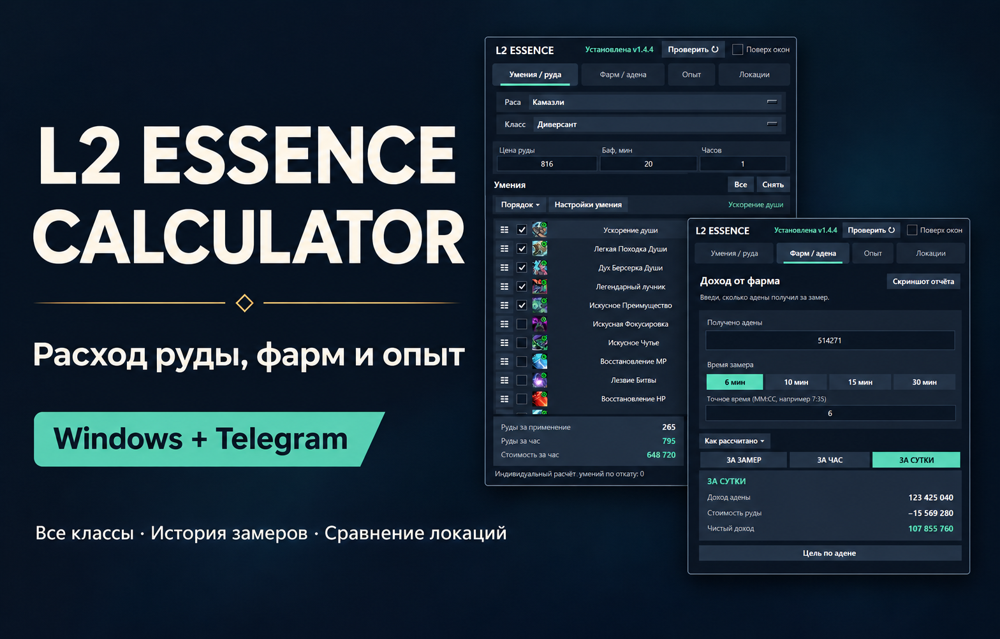
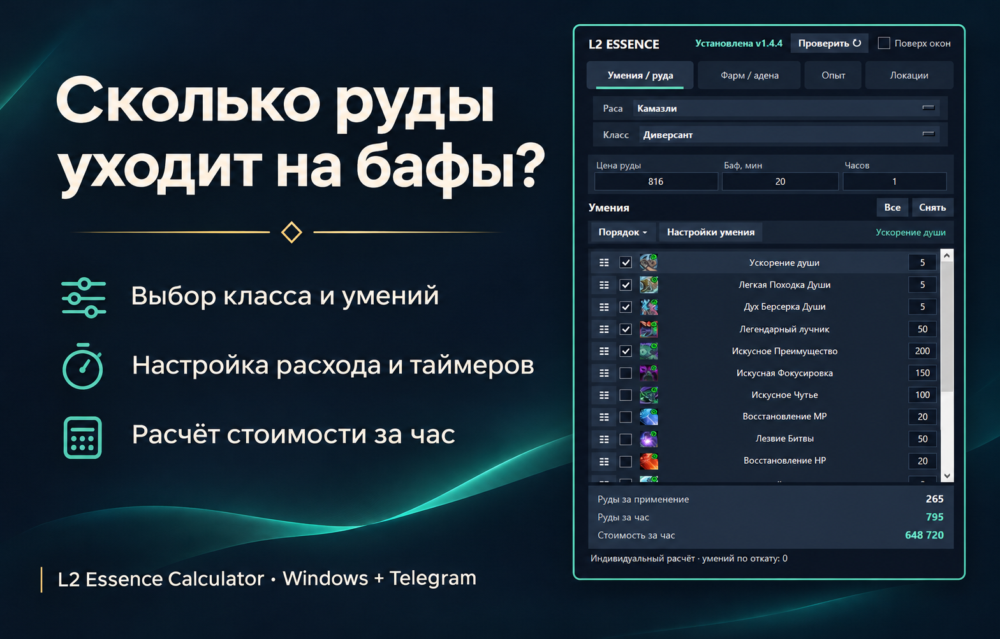
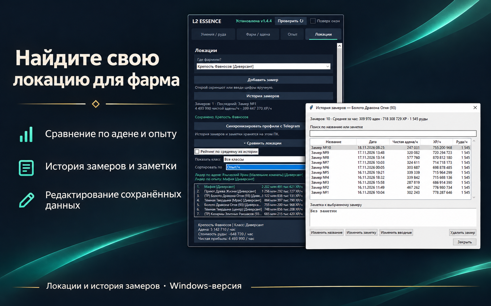

# L2 Essence Calculator

**Чистая адена, опыт и расход Руды Духов для Lineage 2 Essence RU**

46 классов · 8 рас · Windows + Telegram · История замеров и сравнение локаций

### [Скачать для Windows](https://github.com/Teatimo/L2-Essence-Calculator-Updates/releases/latest)

[Открыть в Telegram](https://t.me/L2EssenceCalcBot) · [Приобрести подписку](https://funpay.com/users/11571233/) · [Что нового](https://github.com/Teatimo/L2-Essence-Calculator-Updates/releases)

[Быстрый старт](#быстрый-старт) · [Возможности](#возможности) · [Подписка и поддержка](#подписка-и-поддержка)

---

## Узнай, сколько на самом деле приносит фарм

Полученная адена — только часть результата. L2 Essence Calculator учитывает стоимость руды на выбранные умения, отделяет опыт светочей от обычного фарма и помогает сравнить локации по собственным замерам.

**Выбери класс → настрой умения → добавь игровой отчёт → сравни результаты.** Сохраняй условия фарма и возвращайся к истории, чтобы видеть, где твоему персонажу выгоднее получать адену и опыт.

## Возможности

| Функция | Как это помогает |
| --- | --- |
| **46 классов восьми рас** | Списки умений с русскими названиями и игровыми иконками. |
| **Расход Руды Духов** | Расчёт количества руды и её стоимости за выбранное время и за час. |
| **Настройка умений** | Изменение расхода за применение, длительности баффов и откатов в секундах. |
| **Чистая адена** | Доход за вычетом стоимости руды на выбранные умения. |
| **Опыт без светочей** | Отдельный результат обычного фарма с настраиваемым опытом за светоч. |
| **Импорт скриншота на Windows** | Распознавание данных игрового отчёта с проверкой перед сохранением. |
| **История замеров** | Несколько замеров на локацию, названия, заметки и редактирование сохранённых данных. |
| **Сравнение локаций** | Рейтинг по чистой адене или опыту в час, фильтр по классу и средние результаты истории. |
| **Цель по адене** | Оценка времени до нужной суммы с учётом накопленного и часов фарма в день. |
| **Telegram Mini App** | Расчёты и профили локаций на телефоне с общей подпиской. |
| **Обновления** | Проверка новой версии кнопкой в верхней части приложения. |

## Интерфейс

| Умения и расход руды | Фарм и опыт |
| --- | --- |
|  |  |

| Локации и история | Telegram Mini App |
| --- | --- |
|  |  |

*Нажми на изображение, чтобы открыть его в полном размере. Значения на иллюстрациях — примеры расчётов.*

## Настрой расчёт под своего персонажа

### Умения и руда

Выбери расу и класс, отметь используемые баффы, призывы и другие умения. Укажи цену руды и длительность обычных баффов. Для отдельных умений можно изменить расход, время действия и точный откат в секундах.

Калькулятор покажет, сколько руды требуется и сколько адены она стоит. Перетаскивай умения за значок **☷**: порядок сохраняется отдельно для каждого класса.

### Адена и цель накопления

Введи полученную адену и время замера: готовый период или точное значение в формате **ММ:СС**, например `7:35`. В результате видны доход, стоимость руды и чистая адена.

**«ЗА ЗАМЕР»** использует фактическую длительность. **«ЗА ЧАС»** и **«ЗА СУТКИ»** помогают сравнивать результаты на одном промежутке времени. Суточный прогноз предполагает 24 часа фарма при тех же условиях.

В **«Цель по адене»** укажи нужную сумму, уже накопленное и количество часов фарма в день — получишь оценку оставшегося времени.

### Опыт и светочи

Укажи общий опыт и количество зелёных, синих, фиолетовых и красных светочей. Значения опыта за один светоч можно изменить под уровень персонажа. Калькулятор вычтет их вклад и покажет опыт обычного фарма за замер, час и сутки.

### Импорт игрового отчёта

В Windows можно открыть скриншот или вставить его из буфера обмена. Распознаются адена, общий опыт, время и данные светочей, в том числе числа в миллиардах. Таблица светочей может находиться с любой стороны от отчёта. Распознавание встроено в программу.

**Перед сохранением проверь распознанные числа.** Исправь их при необходимости, выбери или создай локацию, добавь название и заметку, затем нажми **«Сохранить замер»**.

### Локации и история

У каждой локации свой профиль с классом и настройками умений. Сохраняй несколько замеров, отмечай экипировку, баффы и другие условия. В истории доступны поиск по названию и заметке, изменение названия, заметки и вводных данных, а также удаление отдельных замеров.

Сравнивай точки по **чистой адене в час** или **опыту без светочей в час**. Используй фильтр класса и **«Рейтинг по среднему из истории»**, чтобы учитывать несколько сохранённых замеров.

<strong>Все 46 классов — показать список по расам</strong>

| Раса | Классов | Доступные классы |
|---|---:|---|
| **Люди** | 14 | Апостол, Архимаг, Ассасин, Авантюрист, Варг, Дуэлист, Кардинал, Пожиратель Душ, Полководец, Рыцарь Ада, Рыцарь Смерти, Рыцарь Феникса, Снайпер, Чернокнижник |
| **Светлые эльфы** | 8 | Виртуоз, Жрец Евы, Магистр Магии, Мастер Стихий, Рыцарь Смерти, Страж Лунного Света, Странник Ветра, Храмовник Евы |
| **Тёмные эльфы** | 10 | Ассасин, Владыка Теней, Жрец Шилен, Кровавая Роза, Повелитель Бури, Призрачный Охотник, Призрачный Танцор, Рыцарь Смерти, Страж Теней, Храмовник Шилен |
| **Орки** | 5 | Аватар, Всадник Авангарда, Глас Судьбы, Деспот, Титан |
| **Гномы** | 2 | Кладоискатель, Мастер |
| **Камаэли** | 4 | Диверсант, Инквизитор, Каратель, Самурай |
| **Сильфы** | 1 | Мастер Стрельбы |
| **Высшие эльфы** | 2 | Божественный Храмовник, Повелитель Стихий |

## Быстрый старт

1. Открой [последний релиз](https://github.com/Teatimo/L2-Essence-Calculator-Updates/releases/latest).
2. В разделе **Assets** скачай **`L2EssenceCalculator.exe`** и запусти его на Windows 10 или 11.
3. Введи лицензионный ключ. Выбери расу и класс во вкладке **«Умения / руда»** и настрой используемые умения.
4. Перейди в **«Локации» → «Добавить замер»**, загрузи скриншот игрового отчёта или введи данные вручную.
5. Проверь цифры, выбери локацию и сохрани замер. Добавляй новые результаты и сравнивай точки по адене и опыту.

## Калькулятор в Telegram

Открой [**@L2EssenceCalcBot**](https://t.me/L2EssenceCalcBot), нажми **«Открыть калькулятор»** и привяжи подписку одноразовым кодом.

В Mini App доступны расчёты руды, фарма и опыта, а также профили локаций. Данные игрового отчёта вводятся вручную.

Для переноса профилей нажми **«Синхронизировать профили с Telegram»** в Windows, затем **«Обновить профили»** в Mini App. История отдельных замеров и заметки хранятся на ПК.

## Обновления

Установленная версия и кнопка **«Проверить»** находятся в верхней части окна. Если автоматическое обновление не загрузилось, закрой калькулятор, скачай новый `L2EssenceCalculator.exe` из [Releases](https://github.com/Teatimo/L2-Essence-Calculator-Updates/releases/latest) и замени старый файл.

[Посмотреть историю выпусков](https://github.com/Teatimo/L2-Essence-Calculator-Updates/releases)

## Подписка и поддержка

Подписка действует **30 дней с первой активации** и используется в Windows и Telegram. Ключ Windows привязывается к **одному ПК**. Подписку можно продлить; для проверки лицензии требуется интернет.

**[Приобрести или продлить подписку на FunPay](https://funpay.com/users/11571233/)**

По вопросам установки, активации и продления обращайся к продавцу через чат заказа. При ошибке приложи версию программы, описание действий и скриншот без лицензионного ключа.

---

L2 Essence Calculator — независимый инструмент для анализа фарма. Он рассчитывает результаты по введённым данным и загруженным скриншотам, не подключается к игровому клиенту и не управляет персонажем. Чистая адена в расчёте — доход за вычетом стоимости руды на выбранные умения. Прогнозы зависят от исходных данных и условий фарма.
